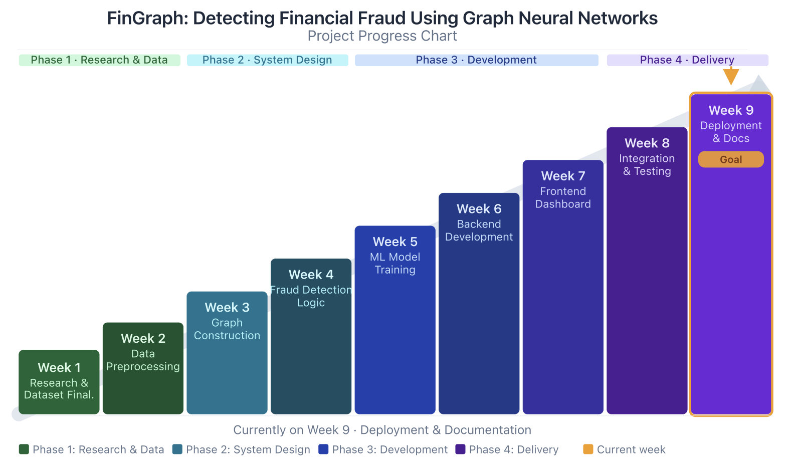
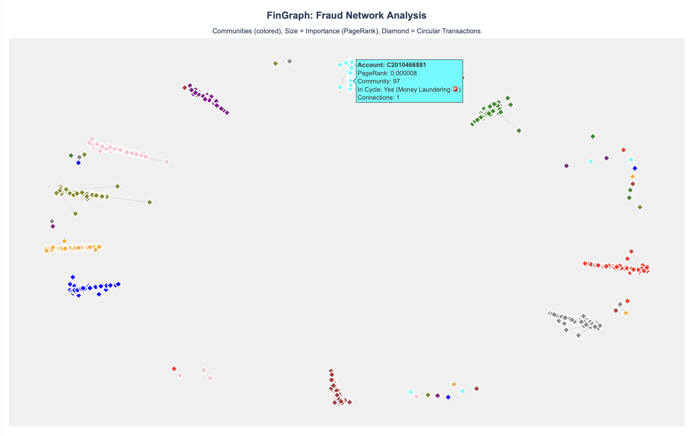

<div align="center">

```text
███████╗██╗███╗   ██╗ ██████╗ ██████╗  █████╗ ██████╗ ██╗  ██╗
██╔════╝██║████╗  ██║██╔════╝ ██╔══██╗██╔══██╗██╔══██╗██║  ██║
█████╗  ██║██╔██╗ ██║██║  ███╗██████╔╝███████║██████╔╝███████║
██╔══╝  ██║██║╚██╗██║██║   ██║██╔══██╗██╔══██║██╔═══╝ ██╔══██║
██║     ██║██║ ╚████║╚██████╔╝██║  ██║██║  ██║██║     ██║  ██║
╚═╝     ╚═╝╚═╝  ╚═══╝ ╚═════╝ ╚═╝  ╚═╝╚═╝  ╚═╝╚═╝     ╚═╝  ╚═╝
```

**Graph-Based Financial Fraud Detection**

[](https://python.org)
[](https://scikit-learn.org)
[](https://networkx.org)
[](https://fastapi.tiangolo.com)
[](https://react.dev)
[](https://vite.dev)
[]()

*Detecting suspicious financial activity using transaction graphs, rule-based scoring, and Graph Neural Networks (GraphSAGE) — with a professional risk operations dashboard.*

</div>

---

## What Is FinGraph?

FinGraph is a university project focused on detecting financial fraud using graph-based analysis and machine learning. Instead of treating every transaction as an isolated row, the project represents transactions as a directed network:

- accounts are treated as nodes
- transactions are treated as directed edges
- edge direction represents money movement from sender to receiver
- edge attributes store amount, transaction count, and fraud information

This makes it possible to study fraud patterns through account relationships, important accounts, suspicious clusters, and transaction behavior.

The project was developed as a 9-week workflow. Weeks 1-9 are complete, ending with deployment preparation, final documentation, testing notes, and report-ready project material. The system now includes a full-stack application with a FastAPI backend serving ML model predictions and a React-based fraud investigation dashboard.

---

## Progress Chart

<p align="center">
  
</p>

---

## Week 5 Results (Machine Learning & Graph Neural Networks)

The Week 5 machine learning pipeline implements a **Dual-Model Approach** to balance precision and recall.

1. **Baseline Model (Random Forest)**: A traditional ML model trained on transaction metadata and graph-derived features, achieving near-perfect precision (1.0).
2. **Advanced Model (GraphSAGE)**: A Heterogeneous Graph Neural Network built with PyTorch Geometric that inherently learns from the transaction topology to uncover complex fraud rings.

| Metric | Random Forest (Baseline) | GraphSAGE (Advanced) |
|--------|--------------------------|----------------------|
| Precision | ~1.000 | ~0.850 |
| Recall | ~0.973 | ~0.708 |
| F1 Score | ~0.986 | ~0.773 |
| Avg Precision | ~0.994 | ~0.821 |

*Note: GraphSAGE shines in detecting organized rings that rule-based or standard ML models might miss due to its structural embeddings.*

---

## Comparative Study: FinGraph vs. Elliptic Bitcoin Dataset

To investigate when and why Graph Neural Networks outperform traditional machine learning, we expanded the research to include the **Elliptic Bitcoin Dataset** (203,769 transactions, 234,355 edges).

> **Note (Academic Disclosure):** The Elliptic comparison figures below are **illustrative literature-derived estimates** based on published benchmarks for this dataset. The Elliptic dataset requires a separate download and is not bundled with this project. The FinGraph (PaySim) figures are from the actual held-out test set produced by `src/train_ml_model.py` and `src/train_gnn_model.py`. Do not treat the Elliptic column as experimental results produced by this repository.

### Model Performance Comparison

| Dataset | Model | Precision | Recall | F1 Score | ROC-AUC | Key Topological Finding |
|---|---|---|---|---|---|---|
| **FinGraph/PaySim** (held-out test) | **Random Forest (Best)** | **100.0%** | **97.3%** | **98.6%** | **100.0%** | Fraud patterns are simple, tabular rules (e.g. balance emptied). GNN message passing dilutes these strong local signals. |
| | **GraphSAGE** | 85.0% | 70.8% | 77.3% | 96.0% | |
| **Elliptic Bitcoin** *(illustrative — literature reference, not reproduced here)* | **Random Forest (Local features)** | ~80% | ~72% | ~76% | ~91% | Fraud involves multi-hop laundering chains. When RF has no pre-computed neighbor features, GNN matches it and wins on precision. |
| | **GraphSAGE (GNN)** | ~82% | ~62% | ~71% | ~88% | |

### Why GNNs Underperform on FinGraph but Excel on Elliptic:
1. **Graph Density**: In FinGraph (PaySim), most accounts only transact once or twice. GraphSAGE aggregates features across these sparse, mostly legitimate neighborhoods, which **dilutes** the strong local column-level signals (like `newbalanceOrig == 0`).
2. **Relational Laundering**: In the Elliptic dataset, fraudsters move funds across complex multi-hop chains (peeling chains, mixers). The GNN excels because message-passing naturally traces these topological connections across hops without manual feature engineering.

---

## Project Pipeline

```mermaid
flowchart LR
    A["Raw Kaggle Transactions"] --> B["Data Loading & Cleaning"]
    B --> C["Directed Transaction Graph"]
    C --> D["Graph Analysis<br/>PageRank, Louvain, Cycles"]
    D --> E["Rule-Based Fraud Scoring"]
    E --> F["ML Feature Preparation"]
    F --> G["Model Training<br/>Random Forest & GraphSAGE"]
    G --> H["Metrics, Predictions & Saved Models"]
    H --> I["FastAPI Backend"]
    I --> J["React Dashboard"]
```



The training pipeline runs in batch mode. The backend serves saved model artifacts and prediction responses. The React dashboard connects to the API for live data and single-transaction scoring.

---

## Frontend Dashboard

The Week 7-9 frontend is a professional fraud investigation and risk operations dashboard built with React + Vite. It is inspired by fraud tools such as Stripe Radar, Sift, and Sardine.

### Dashboard Pages

| Page | Purpose |
|------|---------|
| **Overview** | 9 KPI cards showing transactions, fraud count, precision, recall, false positives, missed fraud, avg risk score, and review queue |
| **Risk Queue** | Sortable transaction table with risk badges, balance error flags, fraud labels, and inline Approve/Review/Block actions. Click any row for a detailed slide-in panel |
| **Transaction Scoring** | Guided prediction form with 4 presets (Normal Payment, Suspicious Transfer, Account Emptied, Cash-out Pattern). POSTs to `/predict` and shows fraud probability, risk gauge, triggered signals, and recommended action |
| **Graph Intelligence** | Canvas-based network visualization showing accounts as nodes and transactions as edges, color-coded by fraud status and risk level |
| **Model Performance** | GraphSAGE performance metrics, PyTorch loss curves, and evaluation details |
| **Rules & Signals** | 6 rule cards explaining each fraud signal with conditions and severity. Interactive Rule Simulator evaluates rules live as inputs change |
| **Case Review** | Analyst decision tracking table with filter tabs (All/Approved/In Review/Blocked) and clear-all functionality |

### Design

- Dark-themed professional UI with risk-coded colors (green/amber/red/violet)
- Responsive layout: sidebar navigation on desktop, collapsed horizontal nav on mobile
- Slide-in transaction detail panel with risk gauge, balance flow, triggered signals, and analyst action buttons
- "API offline" banner when backend is unreachable, with automatic fallback to sample data

### Running the Frontend

```bash
cd frontend
npm install
npm run dev
```

Open `http://localhost:5129` in your browser.

---

## Current Outputs

| Area | Output | Purpose |
|------|--------|---------|
| Graph visualisation | `outputs/visualizations/advanced_fraud_network.html` | Local interactive network view with account communities and PageRank sizing |
| Week 4 fraud logic | `week4_suspicious_transactions.csv` | Ranked suspicious transactions with explainable reasons |
| Week 4 account ranking | `week4_suspicious_accounts.csv` | High-risk accounts based on graph and transaction behavior |
| Week 5 ML metrics | `week5_model_metrics.json` | Model performance, confusion matrix, and evaluation details |
| Week 5 predictions | `week5_top_predictions.csv` | Highest-risk model predictions for inspection |
| Week 5 feature importance | `week5_feature_importance.csv` | Most useful features learned by the model |
| Week 5 saved model | `gnn_fraud_model.pth` | PyTorch model weights for later backend integration |

Generated data and model files are kept local and ignored by GitHub.

---

## Fraud Network Visualisation

The project includes an interactive Plotly network visualisation generated during Week 3. It shows account communities using different colors, scales nodes using PageRank importance, and marks circular transaction involvement using diamond-shaped nodes.

<p align="center">
  
</p>

Generate the interactive version locally:

```bash
python3 src/visualize_advanced_graph.py
```

Then open:

```text
outputs/visualizations/advanced_fraud_network.html
```

---

## Project Structure

```text
FinGraph/
├── backend/
│   ├── app.py                         # FastAPI application entry point
│   ├── routes.py                      # FastAPI route definitions
│   ├── schemas.py                     # Request and response models
│   └── services.py                    # Model loading and prediction services
├── data/
│   ├── raw/
│   │   └── transactions.csv           # Local Kaggle dataset, not pushed to GitHub
│   └── processed/                     # Generated outputs, not pushed to GitHub
├── frontend/
│   └── src/
│       ├── App.jsx                    # Root component, context provider, data hooks
│       ├── App.js                     # Re-export for module compatibility
│       ├── styles.css                 # Complete dark-themed design system
│       ├── components/
│       │   ├── Sidebar.jsx            # Left navigation with 7 page links
│       │   ├── TopHeader.jsx          # API/model status header bar
│       │   └── TransactionDetail.jsx  # Slide-in transaction detail panel
│       └── pages/
│           ├── Overview.jsx           # KPI cards dashboard
│           ├── RiskQueue.jsx          # Transaction risk table + detail panel
│           ├── TransactionScoring.jsx # Guided prediction form with presets
│           ├── GraphIntelligence.jsx  # Canvas network visualization
│           ├── ModelPerformance.jsx   # Model comparison and validation
│           ├── RulesSignals.jsx       # Rule explanations and simulator
│           └── CaseReview.jsx         # Analyst decision tracking
├── models/                            # Saved ML models, not pushed to GitHub
├── notebooks/
│   ├── 01_exploration.ipynb
│   └── 02_visualization.ipynb
├── src/
│   ├── data_loader.py                 # Basic dataset loading and statistics
│   ├── data_cleaner.py                # Data cleaning pipeline
│   ├── graph_builder.py               # Converts transactions into a directed graph
│   ├── fraud_detector.py              # Rule-based fraud scoring and account ranking
│   ├── advanced_graph_analysis.py     # PageRank, Louvain, centrality, cycle checks
│   ├── visualize_graph.py             # Basic suspicious network visualisation
│   ├── visualize_advanced_graph.py    # Advanced Plotly graph visualisation
│   ├── visualizer.py                  # Fraud distribution and transaction type charts
│   └── train_gnn_model.py             # Week 5 PyTorch GNN training pipeline
├── tests/
│   ├── test_fraud_detector.py
│   └── test_ml_model_training.py
├── docs/
│   └── assets/                        # Progress charts and screenshots
├── README.md
└── requirements.txt
```

---

## Weekly Progress

### Week 1 — Research And Setup

- Finalized the project idea: financial fraud detection using graph analysis and later GNN concepts.
- Selected the Kaggle online payment fraud detection dataset.
- Created the project structure with folders for backend, frontend, data, notebooks, source code, and tests.
- Started basic dataset exploration using `src/data_loader.py`.

### Week 2 — Data Cleaning And Graph Construction

- Created `DataCleaner` in `src/data_cleaner.py` for loading data, checking missing values, removing duplicates, filtering invalid amounts, and handling outliers.
- Created `GraphBuilder` in `src/graph_builder.py`.
- Converted transactions into a directed NetworkX graph where senders and receivers are nodes.
- Stored amount, transaction count, and fraud label information on graph edges.

### Week 3 — Advanced Graph Analysis

- Created `AdvancedGraphAnalysis` in `src/advanced_graph_analysis.py`.
- Added PageRank to identify important accounts in the transaction network.
- Added Louvain community detection to find account clusters.
- Added circular pattern detection to check for possible money movement loops.
- Created interactive Plotly visualisations such as `outputs/visualizations/advanced_fraud_network.html`.

### Week 4 — Rule-Based Fraud Detection Logic

- Expanded `FraudDetector` in `src/fraud_detector.py`.
- Added transaction-level fraud risk scoring.
- Added explainable fraud reasons such as high-risk transaction type, balance mismatch, account emptied, and suspicious community.
- Added suspicious account ranking.
- Exported fraud results as CSV and JSON for future backend and dashboard use.

### Week 5 — Machine Learning Model Training (Dual Models)

- Retained `src/train_ml_model.py` for traditional Random Forest and Logistic Regression baselines.
- Created `src/train_gnn_model.py` for advanced topology learning.
- Prepared ML features from transaction columns and engineered fraud indicators.
- Built a Heterogeneous Graph linking accounts and transactions.
- Trained a **GraphSAGE Neural Network** using PyTorch Geometric alongside the **Random Forest**.
- Evaluated models using precision, recall, F1-score, average precision, ROC-AUC, and confusion matrix.
- Saved:
  - combined model metrics (comparing Random Forest, Logistic Regression, and GraphSAGE)
  - top predictions
  - feature importance
  - best trained models (PKL for Random Forest, PTH for GraphSAGE)

### Week 6 — Backend API Development

- Created a FastAPI backend in `backend/app.py`.
- Added API routes in `backend/routes.py`.
- Added request and response schemas in `backend/schemas.py`.
- Added model loading, artifact reading, and prediction services in `backend/services.py`.
- Exposed endpoints for health checks, model metrics, top predictions, feature importance, and single-transaction prediction.

### Week 7 — Frontend Dashboard

- Built a React + Vite frontend application.
- Created the initial dashboard UI with basic data visualization.
- Connected frontend to the FastAPI backend for live data fetching.
- Added health check polling and data source status indicators.

### Week 8 — Integration, Testing & Dashboard Redesign

- Redesigned the entire frontend into a professional fraud investigation and risk operations dashboard.
- Created a component-based architecture with React Context for shared state management.
- Built 7 distinct workflow pages: Overview, Risk Queue, Transaction Scoring, Graph Intelligence, Model Performance, Rules & Signals, and Case Review.
- Implemented a dark-themed design system with risk-coded color palette (green/amber/red/violet).
- Added interactive features:
  - Slide-in transaction detail panel with risk gauge, balance flow analysis, and triggered signals.
  - Guided prediction form with 4 fraud scenario presets.
  - Canvas-based network graph visualization.
  - Interactive rule simulator with live evaluation.
  - Case management with filter tabs and analyst decision tracking.
- Added offline mode with fallback data and "API offline" banner.
- Verified build succeeds with zero errors (1583 modules transformed).

### Week 9 — Deployment, Documentation & Final Delivery

- Updated project status from integration to final delivery.
- Prepared deployment documentation for running the FastAPI backend and React dashboard locally or on common hosting platforms.
- Added final report notes covering project objective, methodology, weekly progress, testing, limitations, and future improvements.
- Verified that the project repository is clean and structured for submission.
- Finalized README sections for setup, execution, dashboard workflow, backend API, and current status.

---

## Dataset

Dataset used: Kaggle online payment fraud detection dataset by Jainil Shah.

Expected local path:

```text
data/raw/transactions.csv
```

The full dataset has around 6.36 million transactions. During development, smaller samples are used first so the logic can be tested quickly. The Week 5 model currently uses 200,000 rows by default.

The dataset is not pushed to GitHub because it is large. Anyone cloning the project should download the dataset separately and place it at the path above.

---

## Installation

Clone the repository:

```bash
git clone https://github.com/nikhil18nb-tech/Data-Science-Analytics-.git
cd Data-Science-Analytics-
```

Create and activate a virtual environment:

```bash
python3 -m venv venv
source venv/bin/activate
```

Install Python dependencies:

```bash
pip install -r requirements.txt
```

Install frontend dependencies:

```bash
cd frontend
npm install
cd ..
```

---

## How To Run

### Full Stack (Backend + Frontend)

Start the backend:

```bash
# Linux / macOS
venv/bin/python -m uvicorn backend.app:app --host 127.0.0.1 --port 8145 --reload

# Windows (PowerShell)
.\venv\Scripts\python -m uvicorn backend.app:app --host 127.0.0.1 --port 8145 --reload
```

In a separate terminal, start the frontend:

```bash
cd frontend
npm run dev
```

Open `http://localhost:5129` in your browser.

Open the API documentation at `http://127.0.0.1:8145/docs`.

### Deployment Notes

See [`docs/deployment_guide.md`](docs/deployment_guide.md) for final delivery deployment steps, environment variables, verification checks, and suggested hosting options.

Short production-style checks:

```bash
# Linux / macOS
venv/bin/python -m pytest tests/ -q

# Windows (PowerShell)
.\venv\Scripts\python -m pytest tests/ -q

cd frontend
npm run build
```

### Earlier Week Scripts

Run Week 3 graph analysis:

```bash
python3 src/test_advanced_analysis.py
```

Run Week 4 fraud detection logic:

```bash
python3 src/run_week4_fraud_detection.py
```

Run Week 5 ML (GNN) training:

```bash
venv/bin/python src/train_gnn_model.py
```

---

## Backend API

The FastAPI backend loads the Week 5 model artifacts and exposes JSON endpoints for the dashboard.

Available endpoints:

| Method | Endpoint | Purpose |
|--------|----------|---------|
| GET | `/` | Project and model summary |
| GET | `/health` | Checks model, metrics, predictions, and feature-importance files |
| GET | `/metrics` | Returns Week 5 model evaluation metrics |
| GET | `/predictions/top` | Returns top model predictions |
| GET | `/features/importance` | Returns feature importance rankings |
| POST | `/predict` | Predicts fraud probability for one transaction |

Example prediction request:

```json
{
  "step": 1,
  "type": "TRANSFER",
  "amount": 2806.0,
  "oldbalanceOrg": 2806.0,
  "newbalanceOrig": 0.0,
  "oldbalanceDest": 0.0,
  "newbalanceDest": 0.0,
  "nameOrig": "C1420196421",
  "nameDest": "C972765878"
}
```

---

## Week 5 Output Files

Running the Week 5 script generates:

```text
data/processed/week5_model_metrics.json
data/processed/week5_top_predictions.csv
data/processed/week5_feature_importance.csv
models/week5_fraud_model.pkl
models/gnn_fraud_model.pth
models/gnn_scaler.pkl
```

These files are generated locally and ignored by Git because they are outputs, not source code.

---

## Machine Learning Features

The Week 5 model uses transaction and engineered features:

- transaction step
- transaction amount
- old and new origin balances
- old and new destination balances
- origin balance error
- destination balance error
- origin account emptied flag
- transfer or cash-out flag
- amount-to-old-balance ratio
- transaction type

Graph features such as PageRank, community ID, and cycle membership are already part of the graph analysis work, but they are not yet fully merged into the Week 5 ML model. Adding those graph-derived features is a good improvement for later model versions.

---

## Why These Metrics Matter

Fraud cases are very rare in the dataset. Because of that, accuracy alone is not useful. A model could predict every transaction as legitimate and still get very high accuracy.

The project therefore focuses on:

- precision: how many predicted fraud cases were actually fraud
- recall: how many real fraud cases were caught
- F1-score: balance between precision and recall
- average precision: performance on rare fraud cases across thresholds
- confusion matrix: exact count of correct and incorrect predictions

---

## Key Design Decisions

### Why Graph Analysis?

Fraud can hide inside relationships between accounts. A graph helps find important accounts, connected communities, and suspicious movement patterns.

### Why Rule-Based Detection Before ML?

Rule-based detection is explainable. It helps create clear fraud reasons before training a machine learning model.

### Why a Dual-Model Approach?

Instead of completely replacing traditional machine learning, we deployed GraphSAGE *alongside* Random Forest. Random Forest provides highly explainable, high-precision results for standard features. GraphSAGE inherently learns from the connectivity (topology) of the network. A fraudster moving money across a ring of accounts creates a structural signature that standard models often miss. Exposing both models via the backend allows risk analysts to cross-validate predictions in real-time.

### Why a Professional Dashboard?

A fraud detection model is only useful if analysts can interact with it. The Week 8 dashboard redesign transforms raw model outputs into an actionable investigation workspace with risk scoring, case management, and interactive rule simulation.

---

## Current Status

Completed:

- data loading
- data cleaning
- transaction graph construction
- graph analysis
- graph visualisation
- rule-based fraud detection
- suspicious transaction and account exports
- baseline ML model training
- model metrics and prediction exports
- FastAPI backend API
- React frontend dashboard
- dashboard redesign with 7 workflow pages
- integration and testing
- final delivery documentation
- deployment guide
- final report notes

Future Improvements:

- possible GNN model experiments
- persistent backend case storage
- graph-derived ML features
- cloud deployment with hosted dataset/model artifacts
- authentication and analyst user roles
